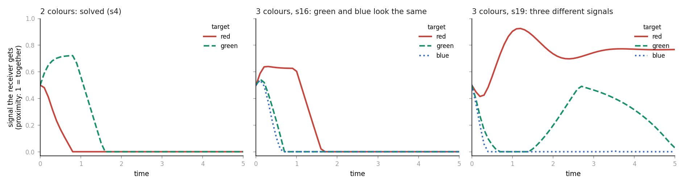
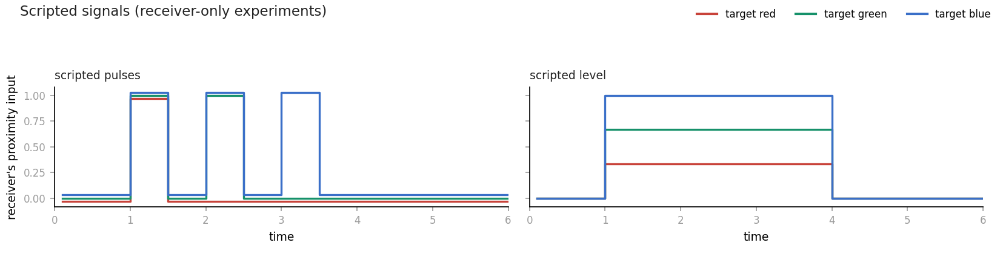

# Signalling-Bots
Evolving simple neural agents to communicate about a target they can’t see, in a task that rules out “pushing” solutions and forces arbitrary, categorical signals, without giving them a communication channel.

## Results so far

**Setup.** Two agents on a line, each a small CTRNN. The signaller stays in the zone 0–1 and knows the target colour.
The receiver starts at 0.75 and must stop at the landmark of that colour; the landmarks (one per colour) are placed
at random in the zone 2–3. The receiver can sense the landmarks' colours, and how close the signaller is (up to a
distance of 1) — that is the only way information can pass. A trial lasts 30 time units.

**Runs.** Each run trains from a different random start (its seed; "s4" is seed 4). The GA evolves a population of
400 genomes for 3000 generations (unless stated), testing each on 4 random layouts × every colour per generation.
At the end, the run's best genome is tested on 100 fixed held-out layouts × every colour; those are the numbers below.
**Mean** and **best** in the tables are across runs.

**Measures.** **Score** is 1 when the receiver ends on the target and falls to 0 at a distance of 0.5 (averaged over
the last 2 time units). **Success** means it ends within 0.1. **Ablated** is the score when the signaller is no longer
told the target colour (its colour inputs are set to 0). If the score depends on the signaller passing on the colour,
it should drop to about the no-information baselines below.

### Baselines (no information about the target)

| | Score | Success |
|---|---|---|
| 2 colours: go to a random landmark | 0.50 | 50% |
| 2 colours: park in the middle of the target zone | 0.44 | 16% |
| 3 colours: go to a random landmark | 0.39 | 33% |
| 3 colours: park in the middle of the target zone | 0.41 | 22% |

### Signaller and receiver together

| Experiment | Runs | Mean score | Best | Mean success | Ablated |
|---|---|---|---|---|---|
| 2 colours, no communication (GA, 6 neurons, 1000 gens) | 1 | 0.55 | 0.55 | 50% | – |
| 2 colours (GA, 6 neurons, 1000 gens) | 5 | 0.69 | **1.00** (s4) | 66% | 0.54 |
| 2 colours (GA, 6 neurons, 3000 gens) | 5 | 0.79 | **1.00** (s4) | 76% | 0.55 |
| 3 colours (GA, 6 neurons, 3000 gens) | 10 | 0.62 | 0.71 (s16) | 57% | 0.41 |

- **2 colours can be solved.** Seed 4 succeeds on every held-out trial. Its signaller goes to a different position
  for each colour.
- **Without communication, evolution found "stop at the first landmark"** (0.55 with 2 colours): always right for
  one colour, wrong for the other.
- **3 colours was only partly solved.** Runs usually solved 1–2 colours. Communication seems to be used in 9 of 10 GA
  runs: hiding the colour drops the score to about 0.41, close to the no-information level.
- **Many 3-colour signallers seem to use only two signals.** In 5 of 10 runs (s10, s12, s14, s16, s18) two colours get
  nearly the same signal, which would make them hard for the receiver to tell apart; s15 sends no signal, and s11's
  three signals include two that are nearly the same. s13, s17 and s19 send three clearly different signals, but
  their receivers still don't decode all three.



*The signal each receiver gets (its proximity input) for each target colour, on one held-out layout (other layouts
look the same). Signals are set by where the signaller moves: towards the receiver raises them, away lowers them.
In s16, green and blue are almost identical, which would explain its scores (1.00 / 0.15 / 1.00).*

### Receiver only, with a scripted signaller (3 colours, 6 neurons)

Is the receiver the bottleneck? The signaller is replaced by a fixed, clean code, so only decoding is left to learn.
**Pulses:** 1, 2 or 3 pulses. **Level:** a steady input of 1/3, 2/3 or 1. GA: 3000 generations. GD: gradient
descent (Adam, backprop through the whole trial), 3000 steps.



*The pulse lines are nudged apart slightly so all three show where they overlap.*

| Code | Method | Runs | Mean score | Best | Mean success | Mean score per colour (R / G / B) |
|---|---|---|---|---|---|---|
| Pulses | GA | 10 | 0.65 | 0.83 (s12) | 57% | 0.82 / 0.33 / 0.80 |
| Level | GA | 10 | **0.70** | **0.85** (s16) | 66% | 0.67 / 0.68 / 0.76 |
| Pulses | GD | 10 | 0.33 | 0.44 | 20% | 0.28 / 0.36 / 0.36 |
| Level | GD | 10 | 0.38 | 0.50 | 24% | 0.28 / 0.30 / 0.55 |

- **Even with a clean signal, no run solved all 3 colours.** The GA receivers usually handled about 2 colours and part
  of the third; the closest was level s19 (0.99 / 0.93 / 0.52, 84% success). Most runs had stopped improving by generation 1500–2000.
- **This suggests the receiver may be a bottleneck on its own**: a scripted signaller with three clean signals helped
  only a little over an evolved one (0.65–0.70 vs 0.62). Together with the two-signal codes above, it seems both sides
  may limit the 3-colour task. More neurons or longer runs could change this.
- **Counting pulses seems hard for the middle colour.** With pulses, green (2 pulses) was rarely solved; with a level
  code the three colours were more even.
- **Gradient descent did worse than guessing.** It seems to have learned to stop between landmarks, which keeps the
  average distance low without using the signal. Possible reasons: the signal comes about 25 time units before it
  matters (gradients may fade over that many steps), it follows one path from one start, and it used roughly 10× less
  compute than the GA. So these runs don't show what gradient descent could do with more tuning.

### Next

- Level code, GA, **10 neurons**: are 6 neurons too few for a 3-way decision plus memory?
- A wider weight range (many weights sit at the ±10 limit).
- More trials per generation: selection uses only 12 trials (4 layouts × 3 colours), which may be too noisy to reward
  small gains on the rarer, harder cases. Check how well a run's elites rank the same on 12 vs 300 trials, then try 16 layouts (48 trials).
- Gradient descent from the best GA receiver, with more trials per step.

## Running

```
python -m evolve 3col_comm --algorithm ga --neurons 6 --seeds 10 11 --generations 3000
python -m train_gd 3col_scripted_level --neurons 6 --seeds 10 11 --steps 3000
python -m analysis.summarize_runs 3col
```

Experiments: `2col_` or `3col_` followed by `comm`, `nocomm`, `scripted` (pulses) or `scripted_level`. Runs are saved to
`results/<experiment>/<algorithm>_n<neurons>_s<seed>_<length>/`. `colab.ipynb` runs them on a Colab GPU and pushes the results.
