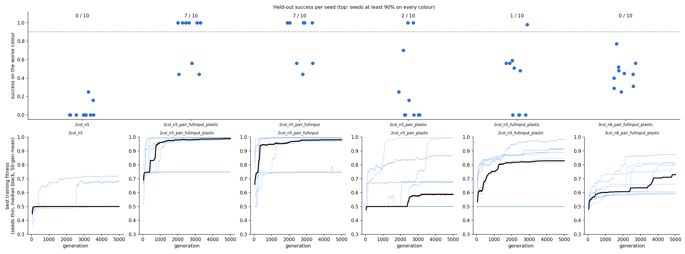
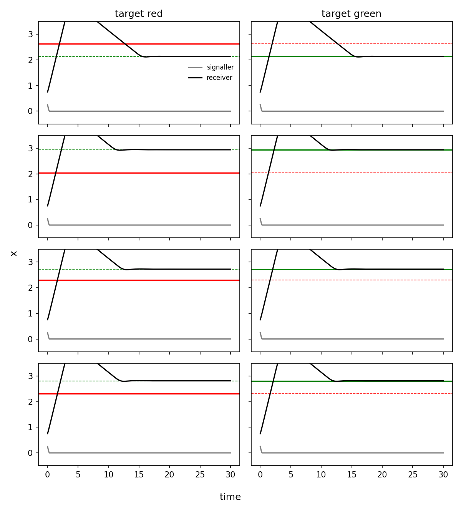
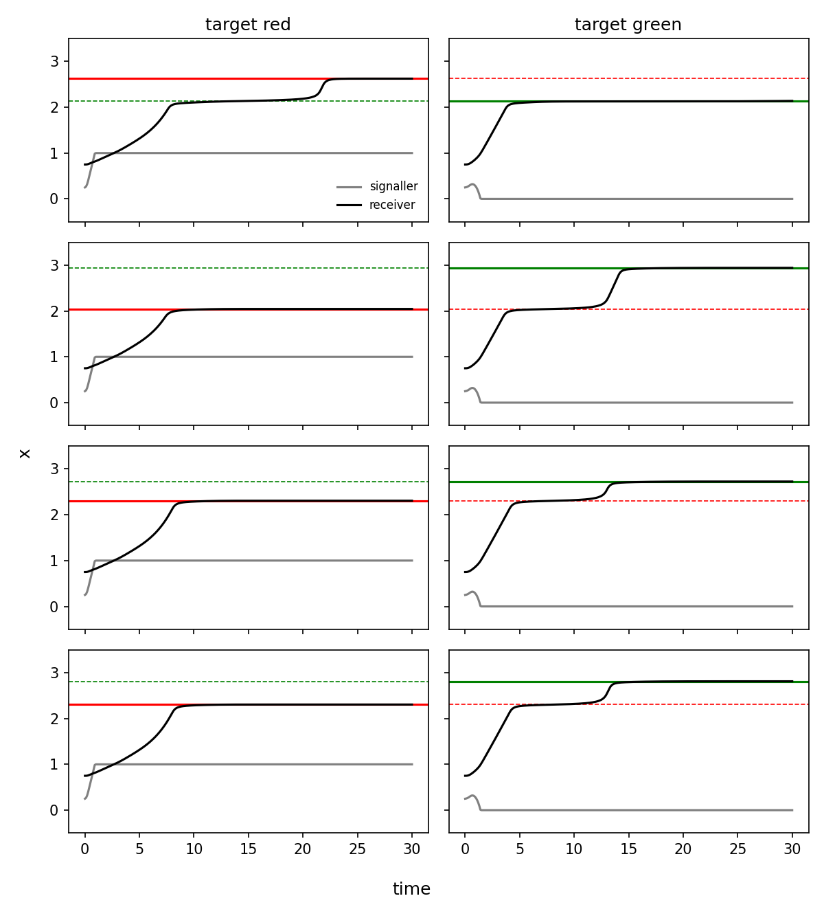
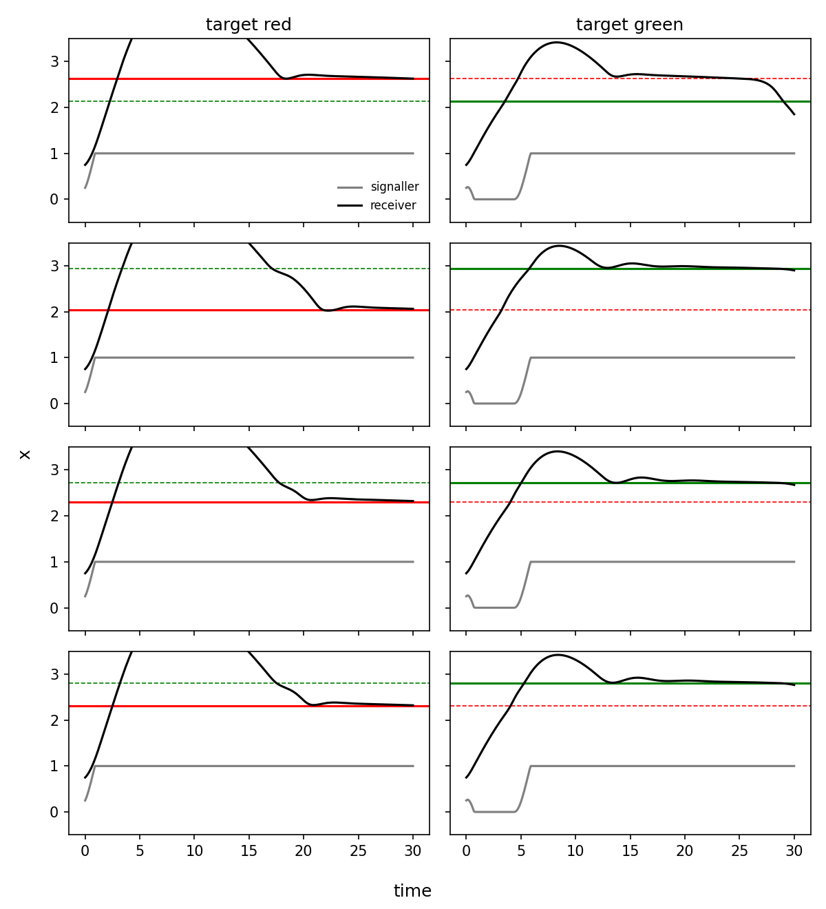
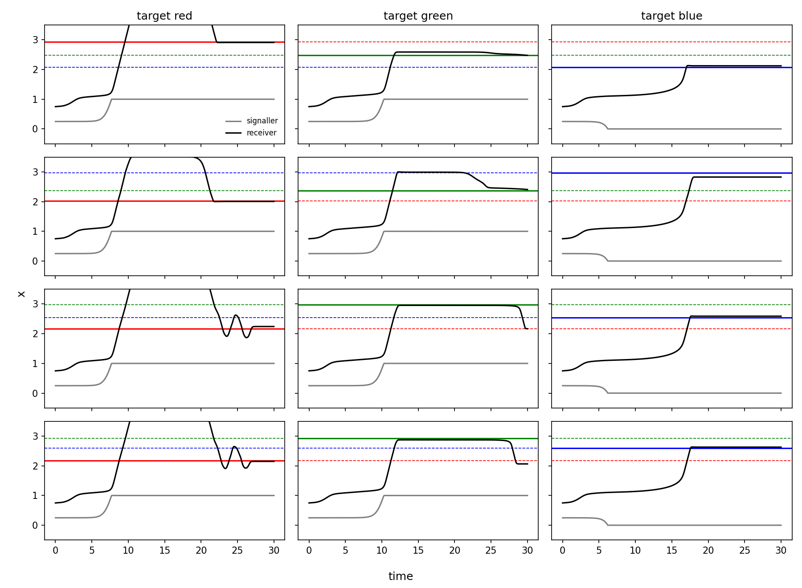

# Signalling-Bots
Evolving simple neural agents to communicate about a target they can't see, without giving them a communication channel.

## Setup

Two agents on a line, each a CTRNN with one neuron per colour plus one for proximity. The signaller stays in 0-1 and is
told the target colour. The receiver starts at 0.75 (signaller at 0.25) and has to stop at the landmark of that colour.
Landmarks are placed at random in 2-3, at least 0.3 apart. Each agent senses how close the other one is; the receiver
also senses each landmark within 0.2. A trial lasts 30 time units (300 steps, dt = 0.1).

By default each sensor feeds one neuron: neuron 0 red, 1 green, 2 blue (3 colours only), then proximity. The last
neuron drives the motor, so with no extra neurons that is the proximity neuron. A genome holds both networks.

**Fitness.** Mean score over every colour order x 10 random layouts x every target colour (40 trials with 2 colours,
180 with 3). The score is 1 on the target, falls to 0 at a distance of 0.5, and is 0 whenever the receiver is nearer
another landmark. It is averaged over the last 2 time units. Layouts are redrawn each generation.

**Evolution.** Population 200, 5000 generations, the top 5% are kept and mutated (Gaussian noise 0.1), no crossover.
Genes start uniform in [-1, 1] and are mapped linearly to weights, biases and input weights in [-10, 10] and time
constants in [0.5, 10].

**Testing.** The best genome of each run is tested on 100 held-out layouts with each target colour. Success means
ending within 0.1 of the target. A run is solved if success is at least 0.9 for every colour, both at dt = 0.1 and
dt = 0.01. The signal check repeats the test with the signaller's colour inputs set to 0.

## Options

| Option | Effect |
|---|---|
| `--colours 2` or `3` | number of colours and landmarks |
| `--extra N` | N neurons without a sensor, after the proximity neuron |
| `--full-input` | every sensor feeds every neuron through its own weight |
| `--motor pair` | two added motor neurons, velocity = right - left |
| `--plastic` | Hebbian weight changes within a trial, with evolved rule genes eta, A, B, C, D |
| `--init 0.3` | starting weight, bias and input weight genes drawn from [-0.3, 0.3]; time constants keep the full range |
| `--centre` | starting biases are centre-crossing, theta_i = -sum_j w_ji / 2 |

Runs are saved to `results/<colours>col_n<neurons>_<options>/s<seed>_g<generations>/`, e.g.
`results/2col_n5_pair_fullinput/s0_g5000/`.

## Running

On Colab, in a new notebook:

```
!git clone https://github.com/migarak2908/Signalling-Bots
%cd Signalling-Bots
%run bots/evolve.py --colours 2 --motor pair --full-input --seeds 0 1 2 3 4 5 6 7 8 9
%run bots/summarize.py 2col_n5_pair_fullinput
%run bots/compare.py 2col_n5_pair_fullinput 2col_n5_pair_plastic --out compare.png
```

`summarize.py` prints held-out success per seed and colour for one results folder. `compare.py` plots, for several folders side
by side, the held-out success on each seed's worse colour and the training fitness of every seed, saved to `results/`.

After `git pull` in the same session, clear the cached modules before the next `%run`:

```
import sys
for name in [m for m in sys.modules if m.startswith("bots")]:
    del sys.modules[name]
```

## Preliminary results

10 seeds per setup, 5000 generations. 2-colour runs have 5 neurons: the base network with `--extra 2`, the others with
the options named.



Top: held-out success on each seed's worse colour, with the number of solved seeds. Bottom: best training fitness, one
thin line per seed and the median in black.

- With the base network no seed solves 2 colours. Most settle at 0.5 fitness: the receiver always goes to one colour.
- The pair motor with full input solves 7 of 10, with or without plasticity. Removing either one drops it to 1 or 2.
- Many failed seeds sit at about 0.75 fitness and 44% or 56% on one colour. Red is on the left in 56 of the 100
  held-out layouts, so these seem to use position for one colour (e.g. "the upper landmark") instead of its colour.
- No 3-colour seed is solved yet. The best (seed 4) reaches 90%, 82% and 77%.

The trajectory plots show the first four held-out layouts (rows) with each target colour (columns). The target is the
solid line, the other landmarks are dashed. Grey is the signaller, black the receiver.

**Base network, 2 colours (seed 0).** The signaller does the same thing for both colours and the receiver always ends
at green.



**Pair motor and full input, 2 colours (seed 0, solved).** The signaller moves next to the receiver for red and away
for green. The receiver stops at the first landmark it reaches and moves on if it is the wrong colour.



**Full input and plasticity, 2 colours (seed 3, 100% red, 56% green).** The signaller moves to the receiver at once for
red and after about 5 time units for green. The receiver overshoots and comes back down. For red it finds the red
landmark, but for green it stops at the upper landmark, which is wrong whenever green is the lower one (top row).



**Pair motor, full input and plasticity, 3 colours (seed 4).** The signal seems to be timing: the signaller moves away
for blue, and towards the receiver for red and green, at about 7 and 10 time units. The receiver mostly finds the
target, but drifts off green late in some trials and stops just short of blue in others.


